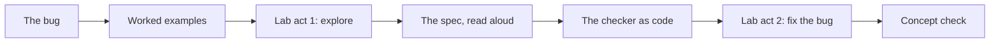

# The payout desk: lessons in TLA+

A series of story-driven lessons on TLA+ and the TLC model checker. You run the payout desk at a small lender. Every lesson opens on a bug in how the money moves, and ends when you fix it yourself in an interactive lab.

**Take the course: [www.estacouveflor.com/tla-lessons](https://www.estacouveflor.com/tla-lessons/)**. The index lists every planned lesson with its status.

Locally, open [index.html](index.html) in a browser: the pages are plain HTML files with `lesson.css` beside them and need no server.

Each lesson folder holds:

- `1-prose.md` and `1-sheet.md`: the lesson text, and the teacher's sheet (objective, terms, misconception, numbers, concept-check answers).
- `checks/`: the Python model checker that computes every number the lesson states.
- `2-figures/`: the figures, built from `figures.mjs` with the shared kit in `_kit/`.
- `3-page/`: the interactive page, built from the prose (`python3 build.py`).

There are no videos in this series.

`series.md` holds the story world, the glossary every lesson shares, and the next bug. `TASKS.md` holds where the build stands. `tokens.css` holds every design value; see [docs/design-tokens.md](docs/design-tokens.md).

## How each lesson works

## How they are made

With the `klay-learning-ladder` skill for Claude Code: [diagram-design](https://github.com/cathrynlavery/diagram-design) for diagrams and the iwrzwr visual archive for lab drawing code.

## License

Lesson text, figures and pages: [CC BY-NC 4.0](https://creativecommons.org/licenses/by-nc/4.0/). Code (labs, checkers, build scripts, figure builders): MIT. See [NOTICE](NOTICE).
