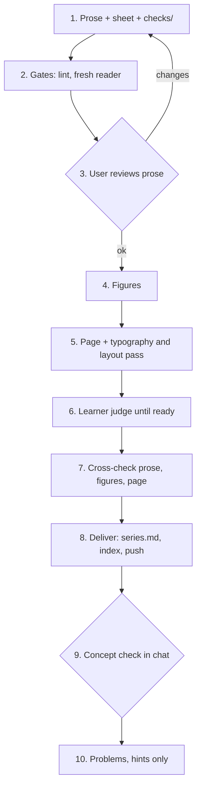

# Tasks

Where the course build stands, so work can resume in a new session on any day. Built with the `klay-learning-ladder` skill. Pages ship as files in this repo, deployed with GitHub Pages; never publish them as Artifacts. No videos in this series (user, 2026-11-21: "do not create video").

To resume: read `series.md` (world, glossary, next bug), then continue from the first unticked box under **Status**. Commit and push after every step (user, 2026-11-21: "deploy as we did with machine learning lessons").

## Source rule

There is no source file for this series. Every claim about TLA+ syntax or TLC behaviour is either run in real TLC or listed in the sheet's Assumptions as unconfirmed. Every number about a spec (states, behaviors, counterexample length) is computed by the lesson's `checks/check.py`, a Python breadth-first checker that mirrors the spec action by action. TLC: OpenJDK from Homebrew (`/opt/homebrew/opt/openjdk/bin/java`) and `~/.local/share/klay-learning-ladder/tla/tla2tools.jar` v1.7.4 (sha256 936a262061c914694dfd669a543be24573c45d5aa0ff20a8b96b23d01e050e88). Each lesson keeps its specs in `checks/*.tla` with a `.cfg`; run `java -cp <jar> tlc2.TLC -deadlock -cleanup <Spec>.tla` (add `-continue` to count every state) and record the result in the sheet's Assumptions.

## Deploy

Repo `github.com/klaygomes/tla-lessons`, GitHub Pages from `main /` via `.github/workflows/pages.yml`, served at https://www.estacouveflor.com/tla-lessons/ (the account's custom domain). Push with the klaygomes gh account (`gh auth switch -u klaygomes`), then switch back to cleiton-loiola. After each edit: `python3 -I _kit/read.py <folder>`, `python3 -I _kit/index.py`, commit, push.

## The learner's rules

- Learner: experienced software engineer (TypeScript, AWS, SQL), new to formal methods.
- Natural teacher voice (`references/writing.md`); no em dashes; curly quotes in prose.
- Concept before symbol; read every TLA+ formula aloud after it appears (each operator in words, the whole as one bold sentence) and mirror it in a short Python snippet with its real output, lines at most 66 characters.
- Ask before spawning judges or browsers (CPU); writer agents are fine. No read-aloud pass in this series (user, 2026-11-27: "no need for this step").
- Never show lesson N+1 before the learner passes lesson N's concept check.

## Visual tools

Under `~/.local/share/klay-learning-ladder/` (paths from `scripts/ensure.sh`): diagram-design for every rule figure (state graphs, behaviors as strips, before/after), stack-diagram for the payout desk's architecture (workers, database, bank), the iwrzwr visual archive for lab drawing code (candidates: `Causal Relay`, `Coupled Nodes`), impeccable for the typography and layout pass, three.js only if an idea is genuinely 3D (unlikely in this series).

## How each lesson is made

## Status

### 1. One loan, paid twice: state machines, behaviors, invariants, model checking

- [x] 1 prose and sheet, with `checks/` (2026-11-21)
- [x] 2 gates (read-aloud dropped by the user, 2026-11-27)
  - [x] `_kit/check_prose.py`: 0 em dashes, 0 lines over 66; fences 4, 9 and 11 fail standalone by design (they continue snippet 1) and pass concatenated (2026-11-21)
  - [x] concept-check answers and the build-it assert verified by script (2026-11-21)
  - [x] read-aloud: dropped by the user (2026-11-27)
  - [x] fresh-reader subagent: 9 findings fixed (four-steps wording, typeset-only phrasing, 13 states dropped, trace-length note, O(S·b) in words, recap and misconceptions de-duplicated, one prediction prompt, four phrasings); build, fit, check_prose rerun by lead; 5 figure requests pending (window timeline, BFS walk-back, merging paths, stuttering, recheck gap) (2026-11-27)
  - [x] TLA+ module run through SANY and TLC 2.19 (tla2tools v1.7.4, sha256 936a2620...0e88): counterexample, 17 states with -continue, claim 32 states, all match (2026-11-21)
- [ ] 3 review stop (user asked to see the figures and lab before reviewing the text, 2026-11-21; building stages 4 and 5 now)
- [x] 4 figures (8 built: desk, race, steps, behavior, orderings, state-graph, growth, claim; all 16 files pass self_check and verify-geometry, rerun by lead; not yet viewed rendered) (2026-11-21)
- [x] 5 page: build.py 0, fit.mjs 0, checker asserts and jsdom smoke test rerun by lead; not yet walked in a browser (2026-11-21)
- [x] 6 learner judge: ready with polish; all numbers agree; fixes done and rechecked by lead: prediction wording, act 1 tally, status line, neutral act 2 labels with a prediction lock, phone spacing, symbol table wrap and glyphs, state-graph crossings and label, phone codes, behavior card overflow, one prose sentence (2026-11-21). No further judges without asking.
- [x] 7 verification: judge cross-checked 20/18, 17, 4 bad, 1,428/75, 26/70/60, 12/32 across prose, figures and labs with its own enumeration; TLC confirms the spec counts (2026-11-21)
- [x] 8 delivery: series.md row, index, deployed at https://www.estacouveflor.com/tla-lessons/01-one-loan-paid-twice/3-page/3-page.html (2026-11-21)
- [ ] 9 concept check: mastery confirmed
- [ ] 10 problems

### 2. The loan nobody paid

- [ ] 1 prose and sheet: drafting done, with checks/ (writer agent, 2026-11-21); tick when it ships. Kept untracked and undeployed: the learner sees it only after passing lesson 1's concept check; commit and push it then.
- [x] 2 gates (read-aloud dropped by the user, 2026-11-27)
  - [x] TLC: 13 runs via `checks/tlc.sh`, rerun by lead, identical to `checks/tlc-results.txt` (2026-11-21)
  - [x] check_prose: 0 em dashes, 0 long lines, no sentence with 2+ inline codes; fences 11 and 18 fail standalone by design (2026-11-21)
  - [x] fresh-reader: all findings fixed (crash continuity, 8 states counted, LivenessOnly cfg explained, WF wording, SCC with a switch example, strong fairness reordered, symbol table and next_steps trimmed, five phrasings); new slots stuttering, enabled, eventually-always, weak-strong, quiet-twin with sheet specs; check_prose, check.py, build_it rerun by lead; prose 6,038 words (2026-11-27)
  - [x] read-aloud: dropped by the user (2026-11-27)
- [ ] 3 review stop
- [x] 4 figures: 12 (stranded, stuttering, safety-liveness, lasso, enabled, fairness, eventually-always, weak-strong, quiet-twin, lease-race, resend, idempotency-key), 24 files; self_check and verify-geometry rerun by lead, 0 failures; model in figures.mjs checks 8, 10, 76, 29, 23. Deviations: lease-race in TLC's order, safety-liveness top strip is lesson 1's race, lasso and stuttering draw once (kit cannot loop). Not yet viewed in a browser (2026-11-27)
- [x] 5 page: build.py 0 (14 slots), fit.mjs 0, rerun by lead; impeccable only lesson 1's three dark-theme false positives; lab.js BFS matches the sheet in all 32 combinations; act 1 question changed to "how many states can stop forever unpaid?" (5) because the prose above answers the sheet's; lab's shortest lease path is Claim(A), Send(A), Expire, Claim(B), Send(B) (5 steps, differs from the prose's TLC path) (2026-11-27)
- [x] 6 learner judge: round 1 ready with polish (raw headings, act 2 ending credited resume for lease+key and all-on wins, lab wording vs prose, captions, small text), round 2 ready with polish (8 items: all-on no longer unlocks, quiet-twin crash marker, ∪ and ¬ explained, prediction answers behind reveals), all fixed; lab matches check.py in 32 of 32 combinations; rerun by lead (2026-11-27)
- [x] 7 verification: verify judge, three views teach one model; lab traces in TLC's order (Expire first); "possible" replaced by "enabled"; lasso is "a path into a reachable loop" (2026-11-27)
- [ ] 8 delivery
- [ ] 9 concept check: mastery confirmed
- [ ] 10 problems
- Glossary terms to add to series.md at delivery: safety property, liveness property, eventually, leads to, stuttering step (lesson 1 named it; lesson 2 defines it), enabled, weak fairness, lasso, idempotency key.

### 3. The key the bank forgot

- [x] 1 prose and sheet: 7,669 words, 8 figure specs, labs, 3 concept checks, 3 problems; 33 TLC runs via `checks/tlc.sh` (`-workers 1`), rerun by lead and identical to `tlc-results.txt`; `check.py` matches; check_prose 0 em dashes, 0 long lines, fence 54 fails standalone by design (2026-11-27). Untracked until lesson 2's concept check passes.
- [x] 2 gates (read-aloud dropped by the user, 2026-11-27) (fresh-reader, read-aloud; continuity pass against lesson 2)
  - [x] fresh-reader (`docs/tla-reviewer-brief.md`): 11 fixes (undefined pay@0 and "asking", generated vs distinct, 8,288 cited unseen, FixStale row order, ForgetKey wrongly credited to lesson 2, Claim's owner from lesson 2); check_prose rerun by lead: 7,827 words, only fence 54 fails (2026-11-27)
  - Unconfirmed in the sheet: liveness of the lossy desk (NoDeadEnd checked instead), the window argument (hand proof, TLC at TTL 2 and 3 only), the bank's "valid until" field (story device).
- [x] 4 figures: 8 (weekend, clock, timeout-guard, clock-bound, two-worlds, stale-answer, deadline, fresh-answer), 16 files, gates rerun by lead, 0 failures; figures.mjs asserts the weekend steps, MaxTime 0 to 6 counts, Ask and FixStale traces; clock-bound short-clock bars neutral, not green (2026-11-27)
- [x] 5 page: build.py 0 (10 slots), fit.mjs 0, rerun by lead after the figures landed; lab.js matches all 48 rows of `checks/lab-table.txt` and 238, 62, 228, 7,252, 43,176, 28,021, 54,305; act 2 succeeds only with the real fix at 48 h with 2 and 3 workers; studies Delay Vernier, Packet Stitch, Context Lease (2026-11-27)
- [x] 6 learner judge: round 1 ready with polish (10 items), round 2 ready with polish (6 small items), all fixed; no luck path (only the real fix of 12 combinations at 48 h); build, fit and check_prose rerun by lead after each round (2026-11-27)
- [x] 7 verification: verify judge, three views teach one model; every count matches TLC; 5 items fixed (win needs the 48 h clock, window ordinals, shorter-schedule clause, grayscale legend, (4471, 0)) (2026-11-27)

### 4. A desk too big to check

- [x] 1 prose and sheet: 6,433 words; 39 TLC runs via `checks/tlc.sh` (`-workers 1`), rerun by lead and identical to `tlc-results.txt` (the 15 s unbounded run included); `check.py` exit 0; check_prose 0 em dashes, 0 long lines, fence 45 fails standalone by design (2026-11-27). Untracked until lesson 3's concept check passes.
- [x] 2 gates (read-aloud dropped by the user, 2026-11-27) (read-aloud; sheet resync)
  - [x] fresh-reader + syntax audit: syntax fixed (generated/distinct/queue and depth explained after the output, CONSTANTS with several values, `{A, B}` in cfg, scope of `\E l \in Loans :`, EXTENDS TLC and Naturals, "action constraint", `<=` in Bounds); "constant" now a recap of lesson 3; constraint mirror replaced; stopped-run numbers made approximate; false "factor of ten" removed; opening recaps lesson 3's real fix; ending rewritten to set up Noor (lesson 5); check_prose rerun by lead: 7,108 words, fence 47 by design (2026-11-27)
  - [x] sheet resync: "constant" a recap, depth added, Next bug leads to Noor's PlusCal rewrite, 15 s run approximate, misconceptions split to four (2026-11-27)
- [x] 4 figures: 5 (explosion, counter, symmetry, constraint, small-scope), 10 files, gates rerun by lead, 0 failures; figures.mjs ports check.py and fails on any mismatch; explosion caption corrected by lead to the real per-loan multipliers with 3 workers (×15, ×11, ×9.5); light theme not viewed (2026-11-27)
- [x] 5 page: build.py 0 (7 slots), fit.mjs 0, rerun by lead; lab.js matches all 72 rows of the sheet's lab table and TLC's 3×3, constraint, deleted-counter and symmetry counts; act 1 question changed to "two lost replies per run, how many states?" (13,195, confirmed by lead with check.py) because the prose answers the sheet's; unbounded runs stop at 200,000 states and say so (2026-11-27)
- [x] 6 learner judge: round 1 ready with polish (8 items), round 2 ready with polish (5 items), all fixed; no luck path (CONSTRAINT, MaxRetries 0 and symmetry with liveness rejected); TLC confirmed depth = states on the longest path (3-step chain prints depth 4) and TLCGet("level") 0 in Init; FloristBudget "232 distinct, depth 4" keeps states up to 3 steps, step 4 generated then cut; rerun by lead (2026-11-27)
- [x] 7 verification: verify judge, three views teach one model; numbers match TLC; fixed off-screen unbounded run, depth wording, MaxRetries 0, deleted-counter ending, "or by you" (2026-11-27)
  - Unconfirmed in the sheet: symmetry hiding a liveness violation (no case built; TLC prints its own warning), the unbounded spec failing liveness by losing every reply, small-scope hypothesis stated as observation.

### 5. Writing the worker as code

- [x] 1 prose and sheet: 6,809 words; 21 pcal.trans translations and 29 TLC runs via `checks/tlc.sh` (`-workers 1`), rerun by lead and identical to `tlc-results.txt`; `check.py` matches; check_prose 0 em dashes, 0 long lines, fences 5, 15, 22 fail standalone by design (2026-11-27). Untracked until lesson 4's concept check passes.
- [x] 2 gates (read-aloud dropped by the user, 2026-11-27) (fresh-reader, read-aloud; continuity pass: one line mentions lesson 3 in general terms)
  - [x] fresh-reader: fixed `\*` comments, deadlock, states generated / left on queue, check.py references, `status[x]`, Terminating, "same 14" with no antecedent, "lesson 1's desk without the key"; 12/32 vs lesson 2's 8 reconciled in prose (sheet may need a note); continuity with lesson 4 not checked (prose missing then); check_prose rerun by lead: 6,951 words, fences 5, 15, 22 by design (2026-11-27)
  - Unconfirmed in the sheet: the "Missing label" rule, Termination checked only under PROPERTY, FIFO pool making fair+ honest, SQL in hints not run.
- [x] 4 figures: 6 (two-calls, labels, translation, interactions, poll, flicker), 12 files, gates rerun by lead, 0 failures; no state counts shown, so nothing gives away the predictions; flicker has about 60 px of empty space above its first row (fix in the layout pass) (2026-11-27)
- [x] 5 page: build.py 0 (8 slots), fit.mjs 0, rerun by lead; lab.js matches check.py (2 workers 8/8/12/21/21/34, 3 workers 20/20/32/114/114/229; counterexamples 4, 6, 6 steps as TLC; placements 000 and 100 refused); studies Section Gate and Choke Pair; act 1 prediction changed (the sheet's is answered above the lab); translator lamp ink/amber, green kept for solved (2026-11-27)
- [x] 6 learner judge: round 1 not ready (rule table leaked, act 2 won by one toggle, raw headings, lost asterisks), round 2 ready with polish (6 items), all fixed; act 2 now opens on Noor's honest spec and only 1 of 16 combinations wins; rerun by lead (2026-11-27)
- [x] 7 verification: verify judge, three views teach one model; numbers match TLC; one name for "mark paid" (`db.setStatus`), undeclared `loan` fixed, stray SVG commas removed (2026-11-27)

### 6. The ledger that does not add up

- [x] 1 prose and sheet: 6,555 words after fixes; TLC runs via `checks/tlc.sh` (`-workers 1`), rerun by lead and identical to `tlc-results.txt`; `check.py` exit 0; check_prose 0 em dashes, 0 long lines, fences 18, 39 by design (2026-11-27). Untracked until lesson 5's concept check passes.
- [x] 2 gates (read-aloud dropped by the user, 2026-11-27) (fresh-reader, read-aloud); syntax audit fixes and the new ending to lesson 7 done (see Open items)
- [x] 4 figures: 7 (two-ledgers, sum-over, conservation, crash-window, two-phase, outbox, at-least-once), 14 files, gates rerun by lead, 0 failures; figures.mjs recomputes every total and stops the build on a mismatch; light theme not viewed (2026-11-27)
- [x] 5 page: build.py 0 (9 slots), fit.mjs 0, rerun by lead; lab.js BFS matches all 16 design/key/loans rows of the sheet; act 1 Moment Balance beam, act 2 Error Escrow chart; fixed only with outbox in the same transaction plus keyed credit at 2 and 3 loans; impeccable only the known dark-theme false positives; lab's liveness lasso is the shortest the search finds, not TLC's 7-step one (2026-11-27)
- [x] 6 learner judge: three rounds, each ready with polish (round 1: 8 items, round 2: 5 incl. "4 of 23 states" wording against check.py, round 3: 5), all fixed; only the same-transaction outbox with the keyed credit wins, at 2 and 3 loans; rerun by lead (2026-11-27)
- [x] 7 verification: verify judge, three views teach one model; stuck loan corrected to 4472 per TLC (prose and sheet); lamp names per design; two-phase lane marked hypothetical (2026-11-27)

### 7. Does the code match the spec?

- [x] 1 prose and sheet: 7,266 words; 27 TLC runs via `checks/tlc.sh` (`-workers 1`), rerun by lead and identical to `tlc-results.txt`; `check.py` exit 0; check_prose 0 em dashes, 0 long lines, fences 23, 27, 30, 34, 36 fail standalone by design (2026-11-27). Untracked until lesson 6's concept check passes.
- [x] 2 gates (read-aloud dropped by the user, 2026-11-27) (fresh-reader, read-aloud; continuity pass: recaps of lessons 3 to 6)
  - [x] fresh-reader + syntax audit: fixed undefined Loan, lease switch, SCC recap, TLC column locations, TablePaid and Pay read-alouds, ENABLED of the mapped Pay, "breadth first" (the code is depth first), `Abstract!Spec` explained two sections late, StutterFree error lines; one-line nod to lesson 3's clock; check_prose rerun by lead: 7,563 words, fences 23, 27, 30, 34, 36 by design (2026-11-27)
  - [x] lesson 6's ending rewritten to lead into lesson 7's opening (2026-11-27)
  - Unconfirmed in the sheet: TLC ignoring THEOREM, the reason TLA+ allows stuttering (general knowledge). `PROPERTY Abstract!Spec` in a cfg is a real TLC error, so the lesson defines `Refines`.
- [x] 4 figures: 7 (pilot, two-levels, implication, mapping-choices, stutter, failure-step, liveness-carried), 14 files, gates rerun by lead, 0 failures; figures.mjs asserts 99/24/224, 122/30, 60 and the no-key trace; implication labels describe the steps instead of naming the designs (would answer a later prediction); two-levels and failure-step run down the page for phone width (2026-11-27)
- [x] 5 page: build.py 0 (9 slots), fit.mjs 0, rerun by lead; no raw hex in sources; lab.js matches check.py (act 1: 99 states, 24 Pay, 224 stutter; 431 with 3 workers; act 2: 60, 122, 99, 272, 566, 431); studies Transcode Window and Revision Strata; act 1's answer-giving table and figure locked until the learner answers; send-first no-key trace is check.py's 7-step order, not TLC's (2026-11-27)
- [x] 6 learner judge: round 1 ready with polish (5 items plus act 2 given away), round 2 ready with polish (7 items incl. playback stalling off screen), all fixed; act 2 asks "pilot with the key off: which lamps go red?" (both; confirmed by lead with check.py: double payout and lasso, not run in TLC), framed as a check of what was read; traces now in TLC's order; rerun by lead (2026-11-27)
- [x] 7 verification: verify judge, three views teach one model; numbers match TLC; pilot trace now TLC's worker A, "the mapping" everywhere, lab lens names match the prose (2026-11-27)
  - [ ] phone lasso figure: the faint "paid, 1" card sits tight against its arrow

### 8. When checking is not enough

- [x] 1 prose and sheet: 5,479 words; 34 TLC runs via `checks/tlc.sh` (`-workers 1`), rerun by lead and identical to `tlc-results.txt`; `check.py` exit 0; check_prose 0 em dashes, 0 long lines, fences 6, 9, 15, 18, 24, 27 fail standalone by design (continue the base snippet) (2026-11-27). Untracked until lesson 7's concept check passes.
- [x] 2 gates (read-aloud dropped by the user, 2026-11-27) (fresh-reader, read-aloud; continuity pass: recap lines for lessons 3 to 7)
  - [x] fresh-reader + syntax audit: 12 syntax gaps fixed (EXTENDS, `/\` binds tighter than `=>`, cfg INIT/NEXT/CONSTANT/INVARIANT, TLC state header, `[A |-> ...]`, generated/distinct/queue, depth, Cardinality and FiniteSets, PROPERTY with `[][StepKeeps]_vars`, FALSE, THEOREM); counting snippet's TypeError fixed (renamed `count_inv`, `count_steps`); CTI rule corrected (check the candidate on reachable states first, then strengthen); busy CTI added; opening and closing moved to Maren (lesson 7's hand-off); recaps of lessons 2, 3, 4, 6 corrected; check_prose rerun by lead: 6,255 words, fences 6, 9, 15, 18, 24, 27 by design (2026-11-27)
  - [x] sheet resync: busy-CTI note, Bug line opens on Maren, recaps corrected, misconceptions split to four (2026-11-27)
  - Unconfirmed in the sheet: TLAPS, Apalache and trace validation not run (tlapm not installed); per-action argument is a hand proof; the 7-worker bug is hypothetical.
- [x] 4 figures: 5 (growth, dominoes, cti, strengthen, one-worker), 10 files, gates rerun by lead, 0 failures; figures.mjs asserts 2N + 2^N, region sizes 144/96/72/49, the TLC CTIs; one-worker draws the other 299 workers idle, not "a few done" as the sheet said (done cannot coexist with another worker's claim) (2026-11-27)
- [x] 5 page: build.py 0 (7 slots), fit.mjs 0, rerun by lead; lab.js matches every candidate mix at 2 and 3 workers and Inv 49/163/541/1,783; act 2 wins only with Owed and Unclaimed; Moment Balance only in the win panel (2026-11-27)
- [x] 6 learner judge: three rounds, each ready with polish (round 1: 8 items, round 2: 7 incl. a regression hiding `first_cti`, round 3: 4), all fixed; act 2 counts only after a weaker candidate's CTI is examined, revealed answers do not count, reachability marker off until answered; round 3 judge re-ran every snippet and assert; rerun by lead (2026-11-27)
- [x] 7 verification: verify judge, three views teach one model; numbers match TLC; spec line matches the prose's Inv, win beam all idle, dominoes "state n", strengthen field key (2026-11-27)
  - [x] sheet: one-worker spec now "all idle but one" (2026-11-27)

## Open items

- [x] `_kit/index.py` links a lesson only once its `1-prose.md` is committed, so it is safe to run any time; unshipped lessons show status and step count without links (2026-11-27)
- Polish left for the learner judge pass (needs the user's OK): lesson 2's lab lease path (Claim A, Send A, Expire, Claim B, Send B) differs from the prose's TLC path; lesson 5's flicker figure has 60 px of empty space on top; light theme not viewed for lessons 4, 6, 7 figures; lessons 6 and 7 labs show check.py's shortest traces where the prose shows TLC's.

- Stages 4 and 5 for lessons 2 to 8 started 2026-11-27 (user: "lets finish this", "spawn more agents"): one figures builder and one page builder per lesson, brief `docs/tla-build-brief.md`. Lead reruns build.py, fit.mjs and the figure gates before ticking. Learner judges, read-aloud and verification still need the user's go-ahead (CPU). Nothing from lessons 2 to 8 is committed or linked until each earlier concept check passes.

- Syntax audit (user, 2026-11-27: "verify ... we aren't including syntax without explaining it before"; brief `docs/tla-syntax-audit-brief.md`). Gaps found, all since fixed (see the line below the list):
  - Lesson 1 (deployed, fix needs user OK and a redeploy): `EXTENDS Naturals`; `![w]` in EXCEPT; UNCHANGED named only by paraphrase, `UNCHANGED status` without `<<>>`; `pc[w]` not in the symbol table; `Check(w) ==` parameter; TLC command `-cp`, `tla2tools.jar`, `tlc2.TLC`; ≤ not in the table; cfg SPECIFICATION and INVARIANT not named.
  - Lesson 2: TLC trace format `State N: <Initial predicate>` / `<Action ...>` (first shown here); "generated" vs "distinct" (line ~417); IF/THEN/ELSE as a value-picking expression, reconciled with lesson 1's "there is no ‘if’ in TLA+"; TRUE/FALSE.
  - Lesson 3: the "Next" label rule at line ~292 is wrong. TLC printed `<Next line 72 ...>` for `\E k \in keys : Forget(k)` (a ∃ around a single call) but split `\E w : Work(w) \/ Crash(w)` down to Claim, Send, ...; in ForgetKey.tla, where Next calls Forget directly, it printed `<Forget ...>`. State what was observed and mark it unconfirmed. Also IF/THEN/ELSE used as a value (lines ~326, ~514); `Deliver(m)`, `Drop(m)`, `Answer(m)` shown before the `\E m \in net` that binds m (line ~671); a leading-`\/` column in Next.
  - Lesson 6: `ON CONFLICT (loan_id) DO NOTHING` decoded one subsection late; `FOR UPDATE`; the Bags module named in passing; inherits lesson 1's `!`.
  - [x] Fixed by fix agents, checks rerun by lead (2026-11-27): lesson 1 (all 8; `!` wording corrected by lead to "a placeholder for the function being changed"; page rebuilt, fit 0, check_prose fences 4, 17, 19 by design; committed 000cf44, push pending: proxy-service.qred.com unreachable), lesson 2 (all 4; owns the TLC trace format and generated vs distinct), lesson 3 (all 4; Next label stated as observed, general rule unconfirmed in the sheet), lesson 6 (ON CONFLICT, Bags, `!` recap, ending rewritten to lead into lesson 7; SKIP LOCKED teaser dropped).
  - Fixed by reviewers: lesson 3 (5), lesson 5 (14), lesson 7 (5). lesson 8 (12), lesson 4 (8).

- Lessons 3 to 8: the first writer agents (2026-11-27, around 17:10) were interrupted after writing only `checks/`. Restarted the same day with `docs/tla-writer-brief.md` (TLA+ brief, TLC capped at `-workers 1`); each agent reuses its lesson's `checks/`.

- TLA+ blocks render typeset (∧ ∨ ≜ ∃ ∈ □ ⟨⟩ ′, module rules) with a CSS-only "Show ASCII" switch: `_kit/highlight.py` `tla()`, styles at the end of `_kit/page.css` (user, 2026-11-21: "add a render for this syntax"). Not yet checked in a browser.

- Waiting on the user: lesson 1's concept check (its three questions were put in chat on 2026-11-27); then review, concept check and problems for each lesson in turn. Each lesson from 2 on is delivered (series.md row and glossary, index, commit, push) only after the previous lesson's concept check passes.
