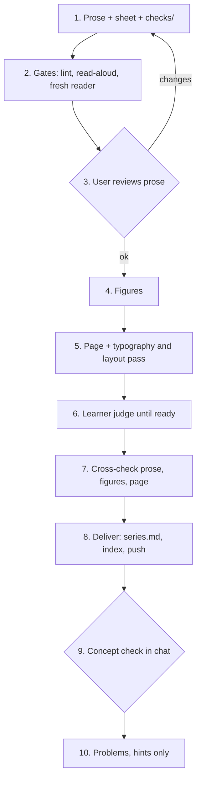

# Tasks

Where the course build stands, so work can resume in a new session on any day. Built with the `klay-learning-ladder` skill. Pages ship as files in this repo, deployed with GitHub Pages; never publish them as Artifacts. No videos in this series (user, 2026-11-21: "do not create video").

To resume: read `series.md` (world, glossary, next bug), then continue from the first unticked box under **Status**. Commit and push after every step (user, 2026-11-21: "deploy as we did with machine learning lessons").

## Source rule

There is no source file for this series. Every claim about TLA+ syntax or TLC behaviour is either run in real TLC or listed in the sheet's Assumptions as unconfirmed. Every number about a spec (states, behaviors, counterexample length) is computed by the lesson's `checks/check.py`, a Python breadth-first checker that mirrors the spec action by action. TLC: OpenJDK from Homebrew (`/opt/homebrew/opt/openjdk/bin/java`) and `~/.local/share/klay-learning-ladder/tla/tla2tools.jar` v1.7.4 (sha256 936a262061c914694dfd669a543be24573c45d5aa0ff20a8b96b23d01e050e88). Each lesson keeps its specs in `checks/*.tla` with a `.cfg`; run `java -cp <jar> tlc2.TLC -deadlock -cleanup <Spec>.tla` (add `-continue` to count every state) and record the result in the sheet's Assumptions.

## Deploy

Repo `github.com/klaygomes/tla-lessons`, GitHub Pages from `main /` via `.github/workflows/pages.yml`, served at https://www.estacouveflor.com/tla-lessons/ (the account's custom domain). Push with the klaygomes gh account (`gh auth switch -u klaygomes`), then switch back to cleiton-loiola. After each edit: `python3 -I _kit/read.py <folder>`, `python3 -I _kit/index.py`, commit, push.

## The learner's rules

- Learner: experienced software engineer (TypeScript, AWS, SQL), new to formal methods.
- Natural teacher voice (`references/writing.md`); no em dashes; curly quotes in prose.
- Concept before symbol; read every TLA+ formula aloud after it appears (each operator in words, the whole as one bold sentence) and mirror it in a short Python snippet with its real output, lines at most 66 characters.
- Ask before spawning judges, browsers or read-aloud passes (CPU); writer agents are fine.
- Never show lesson N+1 before the learner passes lesson N's concept check.

## Visual tools

Under `~/.local/share/klay-learning-ladder/` (paths from `scripts/ensure.sh`): diagram-design for every rule figure (state graphs, behaviors as strips, before/after), stack-diagram for the payout desk's architecture (workers, database, bank), the iwrzwr visual archive for lab drawing code (candidates: `Causal Relay`, `Coupled Nodes`), impeccable for the typography and layout pass, three.js only if an idea is genuinely 3D (unlikely in this series).

## How each lesson is made

## Status

### 1. One loan, paid twice: state machines, behaviors, invariants, model checking

- [x] 1 prose and sheet, with `checks/` (2026-11-21)
- [ ] 2 gates
  - [x] `_kit/check_prose.py`: 0 em dashes, 0 lines over 66; fences 4, 9 and 11 fail standalone by design (they continue snippet 1) and pass concatenated (2026-11-21)
  - [x] concept-check answers and the build-it assert verified by script (2026-11-21)
  - [ ] read-aloud with agent-voice (ask first: CPU)
  - [ ] fresh-reader subagent (ask first)
  - [x] TLA+ module run through SANY and TLC 2.19 (tla2tools v1.7.4, sha256 936a2620...0e88): counterexample, 17 states with -continue, claim 32 states, all match (2026-11-21)
- [ ] 3 review stop (user asked to see the figures and lab before reviewing the text, 2026-11-21; building stages 4 and 5 now)
- [x] 4 figures (8 built: desk, race, steps, behavior, orderings, state-graph, growth, claim; all 16 files pass self_check and verify-geometry, rerun by lead; not yet viewed rendered) (2026-11-21)
- [x] 5 page: build.py 0, fit.mjs 0, checker asserts and jsdom smoke test rerun by lead; not yet walked in a browser (2026-11-21)
- [ ] 6 learner judge
- [ ] 7 verification
- [ ] 8 delivery
- [ ] 9 concept check: mastery confirmed
- [ ] 10 problems

### 2. The loan nobody paid

- [ ] 1 prose and sheet

### 3. The bank that answered twice

- [ ] 1 prose and sheet

### 4. A desk too big to check

- [ ] 1 prose and sheet

### 5. Writing the worker as code

- [ ] 1 prose and sheet

### 6. The ledger that does not add up

- [ ] 1 prose and sheet

### 7. Does the code match the spec?

- [ ] 1 prose and sheet

### 8. When checking is not enough

- [ ] 1 prose and sheet

## Open items

- TLA+ blocks render typeset (∧ ∨ ≜ ∃ ∈ □ ⟨⟩ ′, module rules) with a CSS-only "Show ASCII" switch: `_kit/highlight.py` `tla()`, styles at the end of `_kit/page.css` (user, 2026-11-21: "add a render for this syntax"). Not yet checked in a browser.

- Waiting on the user: review of lesson 1's prose and sheet; go-ahead for the read-aloud and fresh-reader gates.
